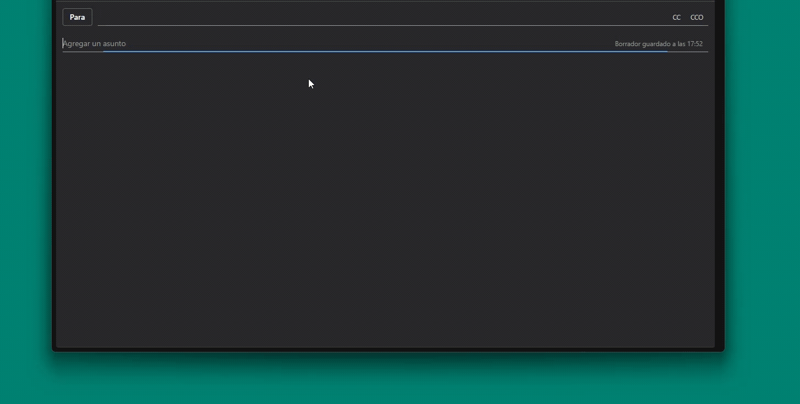

🌐 **Web:** [flowmaticc.github.io](https://flowmaticc.github.io/)  
📥 **Descarga gratuita:** [PlantillasMacro.zip](https://github.com/joseqwrtt/update_app/releases/latest/download/PlantillasMacro.zip)

# Plantillas Macro · Expansor Inteligente de Texto

> **Escribe `/` y elige tu plantilla.** Una herramienta de expansión de texto para Windows que pega tus plantillas de Word, ODT y TXT con formato completo en cualquier aplicación.

---

## 🎬 Demo en acción

---

## ✨ Características Principales

- **⚡ Búsqueda Inteligente**: Escribe `/` seguido de lo que buscas (ej. `/factu`) y aparece un popup con todos los archivos que coinciden con tu búsqueda.
- **🎯 Selección Rápida**: Elige la plantilla que necesitas de la lista y se pega al instante.
- **🎨 Formato Completo**: Conserva toda la estructura de archivos DOCX, ODT y TXT: negritas, tablas, imágenes y estilos.
- **🔒 100% Local**: Tus plantillas se almacenan en tu propio equipo. Sin nube, sin servidores y sin suscripciones.
- **🌐 Funciona en Cualquier App**: Úsalo en Word, Outlook, Excel, Chrome, Slack, Teams o cualquier programa de Windows.
- **📁 Sin Migraciones**: Solo señala la carpeta donde ya tienes tus archivos. Funciona con tus documentos de siempre.

## 🚀 Cómo Funciona

1. **Escribe `/`** en cualquier aplicación.
2. **Añade tu búsqueda**: Por ejemplo, `/factu`.
3. **Aparece un popup** con una lista de todos los archivos que coinciden:
   - Factura octubre 24 041
   - Facturación 2026
   - Facturas modelo p14
4. **Selecciona el que necesitas** y el contenido se pega automáticamente con todo su formato original.

## 🛠️ Tecnología

- **Sistema Operativo**: Windows (compatible con Win10/11)
- **Entorno**: Python
- **Formatos Soportados**: DOCX, ODT, TXT

## 📦 Versiones

**Versión estable actual**: v3.0.0.18
- Novedades: Visita nuestra [página de novedades](https://flowmaticc.github.io/novedades/)

## 🤝 Contribuciones y Soporte

Es un programa gratuito y tu opinión nos ayuda a mejorarlo:
- **Reporta errores**: Abre un issue en [GitHub Issues](https://github.com/flowmaticc/flowmaticc.github.io/issues) con los detalles.
- **Sugiere mejoras**: Cuéntanos tus ideas a través de Issues o correo electrónico.

## 📄 Precio

- **Gratis**: Todas las funciones, sin límite de plantillas.
- **Sin registro**: No necesitas cuenta, email ni licencia que activar.
- **Sin límite de equipos**: Instálalo en todos los ordenadores que quieras.

---

**¿Listo para optimizar tu flujo de trabajo?**  
[Descarga Plantillas Macro](https://flowmaticc.github.io/) gratis, sin límites y sin registro.
